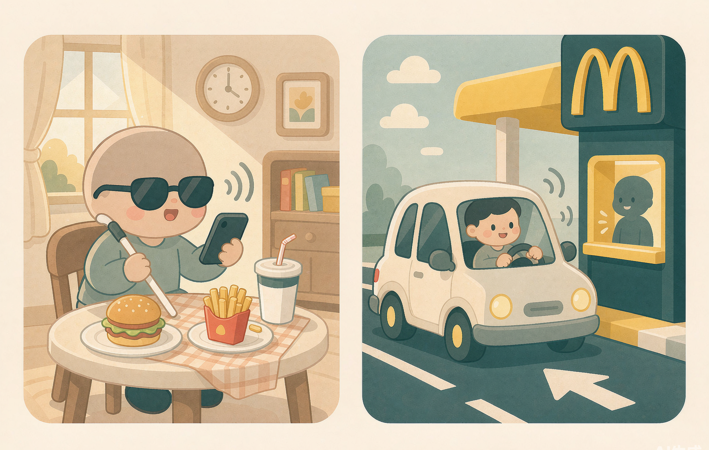

# 对话点餐助手

> 让视障（含开车）的朋友，也能轻松点餐麦当劳。



基于麦当劳 MCP 的对话式点餐 Skill：全程语音 / 文字对话完成「看菜单 → 选餐 → 算价 → 下单 → 取餐」，**零点击、零读屏**。

## 为什么做这个

麦当劳 App 点餐，默认你「看得见、点得动」。但：

- 视障朋友面对图片菜单和取餐二维码，读屏软件帮不上忙；
- 驾车途中碰一下手机，既危险又违法；
- 行动不便的朋友走一遍点餐流程，每一步都是负担。

而麦当劳 MCP 输出的全是结构化数据——菜单、价格、取餐码。**数据本身没有视觉门槛，门槛在人机交互上。** 这个 Skill 把结构化数据翻译成对话，缺口就补上了。

## 它能做什么

- 🎙️ **全程对话**：语音 / 文字完成点餐闭环，无需点击界面
- 🚗 **得来速场景**：免手动语音点餐，到车道报号取餐
- 🦯 **无障碍输出**：取餐码语音播报，读屏友好
- 🗣️ **听懂人话**：普通话 / 粤语 / 英语，宽容方言口音，「车上取」「开车窗口」都懂


## 一段对话（示例，价格为示意）

> **用户**：我刚下高速，帮我点个双层吉士堡套餐，可乐换无糖，去前面那家取。
> **助手**：好的，已找到前方 800 米的 XX 路得来速门店。套餐含中薯条，需要升级大份吗？
> **用户**：不用。
> **助手**：双层吉士堡套餐（可乐换无糖）共 ¥36.5，已用你的会员券省 ¥5。确认下单吗？
> **用户**：确认。
> **助手**：下单成功！取餐编号 **28**，到得来速车道报号取餐即可，不用下车扫码。一路顺风。

## 快速开始

1. 在 [麦当劳 MCP 开放平台](https://open.mcd.cn/mcp) 申请 MCP Token
2. 参考本仓库的 `mcp-config.example.json`，在 WorkBuddy 等 MCP 客户端中配置（将 `${MCD_MCP_TOKEN}` 替换为你的 Token）
3. 安装本 Skill（`SKILL.md`），对它说「帮我点个麦当劳」即可开始
4. 或直接运行可执行演示脚本（不产生真实订单）：
   ```bash
   set MCD_MCP_TOKEN=<你的Token>
   python order_assistant.py 北京 王府井
   ```

## 目标用户

| 用户 | 核心能力 |
|---|---|
| 视障 / 低视力 | 语音点餐、取餐码语音播报 |
| 听障 | 纯文字对话、文字确认单 |
| 行动不便 | 最少步骤下单、外带免排队 |
| 驾车者 | 免手动语音点餐、得来速车道取餐 |

## 项目结构

```
├── SKILL.md                  # Skill 核心定义（状态机 + 无障碍规范）
├── order_assistant.py        # 可运行演示脚本（点餐闭环，不下真实单）
├── MCP_INTEGRATION.md        # 麦当劳 MCP 工具集成说明
├── mcp-config.example.json   # 脱敏 MCP 配置示例
├── CONTEST_DECLARATION.md    # 参赛声明
├── PRD.md                    # 产品需求文档
├── workbuddy.md              # WorkBuddy 开发上下文
├── references/
│   └── terminology.md        # 专有名词等效词典
└── images/                   # 示意图
```

## 声明

本项目为麦当劳程序员创意开发大赛参赛作品，由个人独立开发，非麦当劳官方产品。详见 [CONTEST_DECLARATION.md](CONTEST_DECLARATION.md)。
